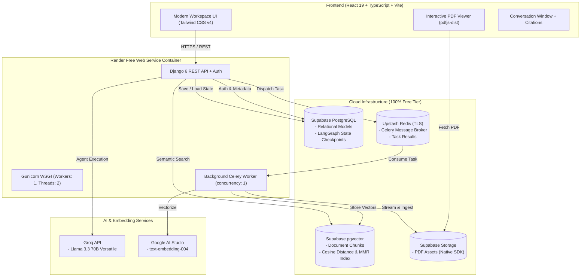

# DocuMind 🧠📄

> **Enterprise-grade Document Intelligence & Agentic RAG Workspace**  
> An open-source, full-stack AI platform designed to transform static PDF documents into interactive, context-aware intelligence environments with precise page citations, short-term conversational threads, and long-term user memory.

[](https://opensource.org/licenses/MIT)
[](https://www.djangoproject.com/)
[](https://react.dev/)
[](https://www.langchain.com/)
[](https://supabase.com/)
[](https://upstash.com/)
[](https://groq.com/)
[](#deployment-architecture)

---

## 🌟 Executive Overview

**DocuMind** is a production-grade full-stack document assistant built for high-accuracy research, document question answering, and structured analysis. Unlike conventional RAG wrappers that run simple similarity searches and dump raw chunks into prompts, DocuMind implements an **Agentic RAG pipeline** powered by LangGraph, Groq Llama 3.3 70B, and Google Gemini embeddings.

It combines an interactive, split-screen PDF viewer with deep page citation tracking, automated document summarization, concept extraction, question generation, and dual-layer memory (short-term conversation checkpointing + long-term user preference extraction via background Celery workers).

Architected for **100% free-tier zero-cost deployment** without sacrificing performance, security, or state persistence.

---

## 🏗️ System Architecture



---

## ✨ Key Features

### 📄 Intelligent Document Reader & Deep Citations
- **Split-Screen Workspace**: Side-by-side reading layout with a custom PDF.js reader and active conversational stream.
- **Interactive Page Citations**: Every claim made by the assistant is grounded with verified source tags (e.g. `[Page 4]`). Clicking a citation automatically scrolls the PDF reader directly to that page and highlights relevant context.
- **Strict Hallucination & Injection Guardrails**: Built-in system prompt defenses enforce document boundary awareness, preventing out-of-scope answers, prompt injection attacks, and personality shifts.

### 🤖 Agentic RAG & Document Tools
- **Maximal Marginal Relevance (MMR) Retrieval**: Diversified chunk retrieval balances semantic relevance against query redundancy.
- **Structured Document Summarization**: Generates executive briefs broken into structured sections and key takeaways.
- **Concept Extraction**: Automatically extracts the top domain concepts and definitions directly from the document.
- **Proactive Question Generation**: Analyzes document sections to synthesize critical review questions that the document answers.

### 🧠 Dual-Layer Memory Architecture
- **Short-Term Conversational Threading**: Integrated with **LangGraph PostgreSQL checkpointer** (`langgraph-checkpoint-postgres`), persisting multi-turn dialogue history across page refreshes.
- **Long-Term User Memory**: Background Celery task analyzes completed dialogues to extract user preferences, learning goals, and domain context into a persistent relational user memory graph.

### ⚡ Resource-Optimized Cloud Architecture
- **Zero-Cost Cloud Deployment**: Runs completely on free-tier infrastructure (Vercel, Render, Supabase, Upstash, Google AI Studio, and Groq) requiring **no credit or debit card**.
- **Ultra-Low Memory Footprint**: Replaces heavy local PyTorch embedding models (~450 MB RAM) with Google Gemini Embeddings API (~15 MB RAM), allowing Django, Gunicorn, and background Celery to co-exist stably inside Render's 512 MB free RAM ceiling.
- **Native Cloud Storage**: Employs Supabase's native Python SDK (`supabase-py`) for PDF storage, eliminating heavyweight S3/boto3 dependencies.

---

## 🛠️ Technology Stack

| Layer | Technologies |
| :--- | :--- |
| **Frontend** | React 19, TypeScript (Strict), Tailwind CSS v4, Vite 8, React Router, `pdfjs-dist`, `react-markdown`, `remark-gfm`, Lucide Icons |
| **Backend Framework** | Python 3.11/3.13, Django 6.1, Django REST Framework (DRF), WhiteNoise, `dj-database-url`, Gunicorn |
| **AI & LLM Orchestration** | LangChain 1.5, LangGraph 1.2, Groq API (`llama-3.3-70b-versatile`), Google Gemini Embedding API (`text-embedding-004`) |
| **Vector Store** | Supabase PostgreSQL + `pgvector` (Cosine distance similarity, MMR search), ChromaDB (local development) |
| **Task Queue & Caching** | Celery 5.x, Upstash Redis over TLS (`rediss://`), `django-celery-results` |
| **Object Storage** | Supabase Storage (native `supabase-py` SDK) |
| **Testing** | Django Test Framework (124 automated unit & integration tests) |

---

## 📁 Repository Structure

```
docuMind/
├── ai_engine/                   # LangChain & LangGraph core AI services
│   ├── agents/                  # DocuMind agent definition & execution logic
│   ├── chains/                  # Summarization, concepts, questions, memory chains
│   ├── rag/                     # Ingestion, embeddings (Gemini/HF), vector stores (pgvector/Chroma)
│   ├── checkpoint.py            # LangGraph PostgreSQL thread checkpointer
│   └── citations.py             # Citation validation and regex extraction
├── backend/                     # Django 6 backend application
│   ├── config/                  # Django project configuration (settings, URLs, wsgi, celery)
│   ├── core/                    # Core business logic app
│   │   ├── models.py            # Document, Conversation, and UserMemory models
│   │   ├── views.py             # REST API endpoints (Auth, Documents, Chat, Tools)
│   │   ├── tasks.py             # Celery background tasks (Ingestion, Memory extraction)
│   │   ├── supabase_storage.py  # Native Supabase Storage backend (supabase-py)
│   │   └── tests/               # 124 unit and integration tests
│   ├── requirements.txt         # Production backend dependencies
│   └── start.sh                 # Production bootstrapper (Migrations + Celery + Gunicorn)
├── frontend/                    # React 19 + TypeScript + Vite frontend
│   ├── src/
│   │   ├── components/          # UI components (PDF viewer, Chat, Upload dialog, Navbar)
│   │   ├── pages/               # Workspace, Dashboard, Login, Register pages
│   │   ├── services/            # Axios API client and endpoints
│   │   └── context/             # Auth, Document, and Toast state providers
│   ├── package.json             # Frontend dependencies
│   ├── vite.config.ts           # Vite configuration with proxy
│   └── vercel.json              # Vercel SPA routing rewrites
├── .env.example                 # Environment variables reference template
├── render.yaml                  # Render Infrastructure-as-Code Blueprint
└── README.md                    # Project documentation
```

---

## 🚀 Getting Started Locally

### Prerequisites
- **Python 3.11+**
- **Node.js 20+** and **npm**
- **PostgreSQL** (or Docker for running Postgres + Redis locally)

### 1. Clone Repository
```bash
git clone https://github.com/your-username/documind.git
cd docuMind
```

### 2. Backend Setup
```bash
# Navigate to backend and create virtual environment
cd backend
python -m venv venv

# Activate virtual environment
# Windows:
venv\Scripts\activate
# macOS/Linux:
source venv/bin/activate

# Install dependencies
pip install -r requirements.txt

# Configure environment variables
cp ../.env.example .env
```

Edit `.env` with your API keys:
```env
DEBUG=True
SECRET_KEY=local-dev-secret-key-change-in-production
GROQ_API_KEY=gsk_your_groq_api_key
GEMINI_API_KEY=AIzaSy_your_gemini_api_key
```

Run database migrations and start server:
```bash
python manage.py migrate
python manage.py runserver
```

*(Optional)* Run Celery worker locally for asynchronous ingestion:
```bash
# Windows:
python -m celery -A config worker --loglevel=info --pool=solo
# Linux/macOS:
celery -A config worker --loglevel=info
```

### 3. Frontend Setup
```bash
cd ../frontend
npm install
npm run dev
```

Open [http://localhost:5173](http://localhost:5173) in your browser. The Vite dev server automatically proxies `/api` and `/media` requests to `http://localhost:8000`.

---

## 🧪 Testing Suite

DocuMind includes a comprehensive test suite covering authentication, document permissions, memory isolation, RAG retrieval, prompt injection defense, and Supabase storage operations:

```bash
# Run all backend tests
cd backend
python manage.py test core
```
```
Found 124 test(s).
Creating test database for alias 'default'...
...................................................................................
----------------------------------------------------------------------
Ran 124 tests in 8.972s

OK
```

```bash
# Run strict TypeScript validation & build in frontend
cd frontend
npm run typecheck
npm run build
```

---

## ☁️ Zero-Cost Cloud Deployment Guide

This project is tailored specifically for **zero-cost, zero-credit-card deployment**:

| Component | Target Service | Free Tier Limits |
| :--- | :--- | :--- |
| **Frontend** | [Vercel](https://vercel.com/) | 100 GB bandwidth, unlimited deployments |
| **Backend API + Worker**| [Render](https://render.com/) | 512 MB RAM, 0.1 CPU, spins down on idle |
| **Database & Vector Store**| [Supabase](https://supabase.com/) | 500 MB PostgreSQL with pgvector extension |
| **File Storage** | [Supabase Storage](https://supabase.com/) | 1 GB free bucket storage |
| **Message Broker** | [Upstash](https://upstash.com/) | 10,000 commands/day free Redis |
| **LLM Inference** | [Groq](https://console.groq.com/) | High-rate free tier for Llama 3.3 70B |
| **Embeddings** | [Google AI Studio](https://aistudio.google.com/)| 1,500 requests/day free tier |

### Step-by-Step Production Deployment
1. **Database & Vectors (Supabase)**: Create a free project at [Supabase](https://supabase.com/). In SQL Editor, execute:
   ```sql
   CREATE EXTENSION IF NOT EXISTS vector;
   ```
   Create a public bucket named `documind-pdfs` in **Storage**.
2. **Queue (Upstash)**: Create a free Redis database at [Upstash](https://upstash.com/) and copy the TLS connection string: `UPSTASH_REDIS_URL=rediss://:PASSWORD@HOST:PORT`.
3. **Deploy Backend (Render)**:
   - Create a **Web Service** pointing to your repository with root directory `backend`.
   - Build Command: `pip install -r requirements.txt`
   - Start Command: `bash start.sh`
   - Set environment variables as documented in [.env.example](.env.example).
4. **Deploy Frontend (Vercel)**:
   - Import your repository to [Vercel](https://vercel.com/) with root directory `frontend` and framework preset `Vite`.
   - Set Environment Variable: `VITE_API_BASE_URL=https://<your-render-service>.onrender.com/api`.
   - Update `CORS_ALLOWED_ORIGINS` in Render with your new Vercel domain.

---

## 🔒 Security & Guardrails

- **JWT / DRF Token Authentication**: Full route authorization ensuring users can only read, process, query, and delete documents and conversations they own.
- **Prompt Injection Hardening**: Specialized system prompt structure forbids instruction override attacks and role deviation.
- **Resource Cleanup**: Automated garbage collection purges vector collections, conversation memory checkpoints, and cloud PDF files when a document is deleted.
- **Strict HTTPS / TLS**: Upstash Redis communicates strictly over encrypted TLS sockets (`rediss://`), and Supabase PostgreSQL enforces SSL mode.

---

## 📄 License

Distributed under the MIT License. See `LICENSE` for more information.

---

## 👨‍💻 Author & Contact

Developed as an advanced full-stack AI and RAG portfolio project.  
- **GitHub**: [@developerarhan](https://github.com/developerarhan)   
- **Email**: khanarhan0205@gmail.com
